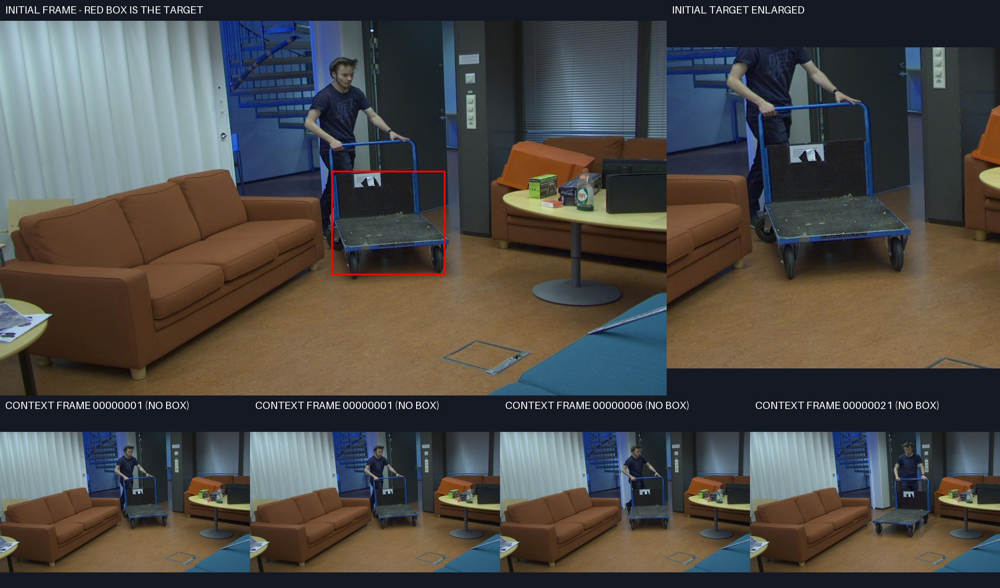

# 推车首帧：文字描述与视觉参照的区域范围

本次只读取本地既有审核图、官方初始化绑定和源码。CPU名义采样位置检查native38b279真实exit0；没有新读取服务器、GPU、训练进度或执行神经网络。

图中只有一辆推车。初始化GT框主要覆盖较低的推车主体、平台和车轮；蓝色侧管在框内仍可见，顶部横扶手大部分在框外。cart / blue tubular rails / dark flat platform / dark wheels是受图像支持的描述。本次不修改人工类别或属性，不能把GT框没有完整覆盖所有部件解释成文字错误。

DenseTargetDecoder.observe对RGB、Depth、融合和CLIP四种首帧特征，分别按初始化GT框采样4×4个位置，归一化坐标轴为0.125 / 0.375 / 0.625 / 0.875。记录里的16个原图位置是根据保存bbox和源码公式计算的名义double坐标，不是新读取的实际float32 grid_sample坐标、值或权重。

这不是把16个孤立像素裁出来：sample_regions读取的是已有稠密视觉特征。位置在GT内，不证明特征不含上下文，也不证明框外顶部横扶手的信息完全丢失；本次没有测量token感受野、attention或每条属性的实际支持。右侧“target enlarged”也是审核素材，不应直接当作网络内部参照图。

当前文字通过软响应参与选择，尚未完成对当前预测框的逐属性核验。首次跳框的候选缺失、评分、几何精修原因仍需整套M124及选定best VOT终态后的同状态回放，不能由这张首帧图唯一判定，也不能把历史CurrentC跳框当成最新M124结果。既有实验、05:27:55.728405检查节点与唯一native79259/functions423等待不变。
